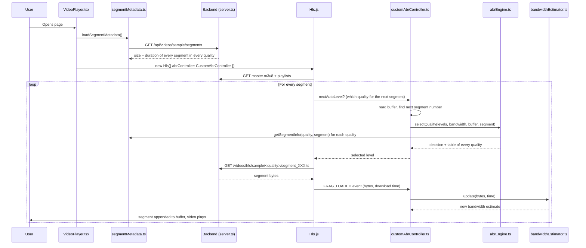

# Adaptive Bitrate Streaming (ABR) – Proof of Concept

A video player that streams HLS video and **chooses the video quality for every segment using its own ABR (Adaptive Bitrate) algorithm**, instead of relying on the player library's built-in logic.

The main idea: the backend knows the **real size of every segment** in every quality. Before downloading the next segment, the player calculates how long that exact segment will take to download with the current bandwidth, and checks whether the buffer can survive that wait. It then picks the highest quality that is safe.

This is the same basic principle used by YouTube, Netflix and other streaming platforms: the video is split into small segments in multiple qualities, and the player decides the quality segment by segment.

---

## Table of contents

- [Tech stack](#tech-stack)
- [Project structure](#project-structure)
- [How it works – the full flow](#how-it-works--the-full-flow)
- [The ABR logic](#the-abr-logic)
- [What each file does](#what-each-file-does)
- [Setup and running](#setup-and-running)
- [Creating the video segments](#creating-the-video-segments)
- [Testing the ABR](#testing-the-abr)
- [Reading the console output](#reading-the-console-output)
- [Tuning parameters](#tuning-parameters)
- [Limitations and next steps](#limitations-and-next-steps)

---

## Tech stack

| Part | Technology |
|---|---|
| Backend | Node.js, Express, TypeScript |
| Frontend | React, Vite, TypeScript |
| Streaming | HLS (HTTP Live Streaming) with [hls.js](https://github.com/video-dev/hls.js) |
| Encoding | ffmpeg (libx264 video, AAC audio) |

---

## Project structure

```
adaptive-bitrate-sync-poc/
├── backend/
│   ├── src/
│   │   └── server.ts               # Serves HLS files + segment metadata API
│   └── videos/
│       ├── source/                 # Original .mp4 input (not served)
│       └── hls/
│           └── sample/
│               ├── master.m3u8     # Master playlist (lists all qualities)
│               ├── 360p/           # playlist.m3u8 + segment_000.ts ...
│               ├── 480p/
│               ├── 720p/
│               └── 1080p/
│
└── frontend/
    └── src/
        ├── components/
        │   └── VideoPlayer.tsx     # React player, creates Hls.js with our ABR
        └── abr/
            ├── customAbrController.ts  # Plugs our ABR into Hls.js
            ├── abrEngine.ts            # The decision algorithm
            ├── bandwidthEstimator.ts   # Measures network speed
            └── segmentMetadata.ts      # Loads real segment sizes from backend
```

---

## How it works – the full flow



### Step by step

1. **Page loads.** `VideoPlayer.tsx` first calls `loadSegmentMetadata()`. This fetches the real size and duration of every segment in every quality from the backend and keeps it in memory.
2. **Player is created.** Hls.js is created with `abrController: CustomAbrController`, so Hls.js asks **our** controller which quality to load instead of using its own logic.
3. **Playlists load.** Hls.js downloads `master.m3u8`, which lists the 4 qualities (360p, 480p, 720p, 1080p), and then each quality's `playlist.m3u8`.
4. **Before each segment download**, Hls.js reads `nextAutoLevel` from our controller. The controller:
   - measures how many seconds of video are buffered ahead of the playback position,
   - finds the next segment number (the segment that starts where the buffer ends, so this also works after seeking),
   - calls `selectQuality()` in `abrEngine.ts`,
   - prints the decision in the console and returns the chosen quality.
5. **Hls.js downloads** that segment at the chosen quality.
6. **After the download**, the `FRAG_LOADED` event gives us the bytes and the time taken. `bandwidthEstimator.ts` turns this into a new bandwidth estimate, which is used for the next decision. The console also shows the predicted vs the actual download time.
7. The segment is added to the buffer and plays. The loop repeats for every segment until the video ends.

---

## The ABR logic

The algorithm lives in `frontend/src/abr/abrEngine.ts`.

### Inputs

| Input | Source |
|---|---|
| Bandwidth estimate (Mbps) | `bandwidthEstimator.ts`, measured from real downloads |
| Buffer ahead (seconds) | `video.buffered` minus `video.currentTime` |
| Next segment number | Segment that starts where the buffer ends |
| Real segment size + duration | Backend metadata API |

### Step 1 – Safety margins

We never trust the numbers 100%:

```
safe bandwidth = estimated bandwidth × 0.8
usable buffer  = current buffer      × 0.8
```

### Step 2 – Special cases

| Condition | Decision |
|---|---|
| Buffer ≤ 2 seconds | **Emergency** → lowest quality immediately |
| Bandwidth unknown (first segment) | Lowest quality |

### Step 3 – Check every quality for the next segment

For each quality, using the **real size** of the next segment:

```
download time = segment size (MB) × 8 / safe bandwidth (Mbps)
```

A quality is **safe** only if both rules pass:

| Rule | Condition | Why |
|---|---|---|
| No stall | download time ≤ usable buffer | Playback won't run out of video while we wait |
| Sustainable | download time ≤ segment duration | We download 4 s of video in ≤ 4 s, so the buffer doesn't shrink |

### Step 4 – Pick

- The **highest safe quality** is selected.
- If no quality is safe → the lowest quality is used as a fallback.

### Example

Bandwidth 3.0 Mbps, buffer 15 s, next segment is 4 s long:

```
safe bandwidth = 3.0 × 0.8 = 2.4 Mbps
usable buffer  = 15  × 0.8 = 12 s

360p   0.46 MB → 0.46 × 8 / 2.4 = 1.53 s   ✅ safe
480p   0.67 MB → 0.67 × 8 / 2.4 = 2.23 s   ✅ safe  ← SELECTED
720p   1.35 MB → 1.35 × 8 / 2.4 = 4.50 s   ❌ 4.50 > 4 s (buffer would shrink)
1080p  2.70 MB → 2.70 × 8 / 2.4 = 9.00 s   ❌ 9.00 > 4 s (buffer would shrink)
```

### Why real segment sizes matter

Segment duration is fixed (4 s), but **segment size is not**. The encoder uses more bits for complex scenes (action, fast motion) and fewer for simple scenes (someone talking). A player that only looks at the playlist's average bitrate can pick a high quality right before a very heavy segment and stall. Because this player knows the exact size of the next segment, it can avoid that.

### Bandwidth estimation

`bandwidthEstimator.ts` uses **two moving averages** (the same idea Hls.js uses):

```
sample = bytes × 8 / download time

fast = 0.5  × sample + 0.5  × fast     (reacts quickly)
slow = 0.15 × sample + 0.85 × slow     (stable)

estimate = min(fast, slow)
```

- When the network **gets worse**, the fast average drops quickly, so we switch down quickly.
- When the network **gets better**, the slow average rises slowly, so we switch up carefully and avoid jumping back and forth.
- Downloads smaller than 16 KB are ignored (request latency dominates them).
- Each sample is capped at 100 Mbps, because localhost or the browser cache can report ~0 ms downloads.

---

## What each file does

### Backend

#### `backend/src/server.ts`
- Runs an Express server on `http://localhost:5000`.
- Adds CORS headers so the Vite frontend (`http://localhost:5173`) can access it.
- Serves the HLS files statically at `/videos/hls/...` (playlists and `.ts` segments).
- Provides the **segment metadata API**:

  `GET /api/videos/sample/segments`

  For each quality it reads the segment files and `playlist.m3u8`, and returns the real file size and duration of every segment:

  ```json
  {
    "video": "sample",
    "qualities": [
      {
        "index": 0,
        "name": "360p",
        "segments": [
          { "segment": 0, "sizeBytes": 531476, "duration": 4 },
          { "segment": 1, "sizeBytes": 504216, "duration": 4 }
        ]
      }
    ]
  }
  ```

  The quality `index` must match the Hls.js level index (0 = 360p … 3 = 1080p).

### Frontend

#### `frontend/src/components/VideoPlayer.tsx`
- The React component that renders the `<video>` element.
- Loads the segment metadata **before** playback starts.
- Creates Hls.js with our `CustomAbrController` and buffer limits (`maxBufferLength: 20`, `maxMaxBufferLength: 30`).
- Logs the available qualities and the quality that is **actually playing** (`NOW PLAYING`).
- Handles errors: hides harmless "aborted" warnings and recovers from fatal network and media errors.

#### `frontend/src/abr/customAbrController.ts`
- The bridge between Hls.js and our algorithm.
- Hls.js reads `nextAutoLevel` from this class right before every segment request.
- Calculates the current buffer and the next segment number.
- Calls `selectQuality()` **once per segment** and caches the result, because Hls.js reads the value many times.
- Listens to `FRAG_LOADED` to update the bandwidth estimate and compare the predicted and actual download time.
- Ignores Hls.js "echoing" our own level back, and only accepts real down-switches that Hls.js makes after fragment errors.
- Prints the readable console report for every segment.

#### `frontend/src/abr/abrEngine.ts`
- The **decision algorithm** described above.
- A pure function: it only calculates and returns the decision plus a table of every quality. It does no logging, which makes it easy to test.

#### `frontend/src/abr/bandwidthEstimator.ts`
- Converts each download (bytes + time) into Mbps.
- Smooths the measurements with the fast/slow averages.

#### `frontend/src/abr/segmentMetadata.ts`
- Fetches the metadata API once and stores the result.
- `getSegmentInfo(quality, segment)` returns the size and duration of one specific segment.

---

## Setup and running

### Requirements

- Node.js 18+
- ffmpeg (`sudo apt install ffmpeg`)

### Backend

```bash
cd backend
npm install
npm run dev        # or the start script defined in backend/package.json
```

Runs on `http://localhost:5000`.

### Frontend

```bash
cd frontend
npm install
npm run dev
```

Runs on `http://localhost:5173`.

### Quick checks

| URL | Expected |
|---|---|
| `http://localhost:5000/videos/hls/sample/master.m3u8` | The master playlist text |
| `http://localhost:5000/api/videos/sample/segments` | JSON with all segment sizes |
| `http://localhost:5173` | The video player |

---

## Creating the video segments

Put a source video in `backend/videos/source/`, then run this from `backend/videos/hls/sample/`:

```bash
ffmpeg -i ../../source/input.mp4 \
  -filter_complex "[0:v]split=4[a][b][c][d]; \
    [a]scale=640:360[v360];[b]scale=854:480[v480]; \
    [c]scale=1280:720[v720];[d]scale=1920:1080[v1080]" \
  -map "[v360]"  -c:v:0 libx264 -b:v:0 800k  -maxrate:v:0 900k  -bufsize:v:0 1600k \
  -map "[v480]"  -c:v:1 libx264 -b:v:1 1400k -maxrate:v:1 1500k -bufsize:v:1 2800k \
  -map "[v720]"  -c:v:2 libx264 -b:v:2 2800k -maxrate:v:2 3000k -bufsize:v:2 5600k \
  -map "[v1080]" -c:v:3 libx264 -b:v:3 5000k -maxrate:v:3 5350k -bufsize:v:3 10000k \
  -map a:0 -map a:0 -map a:0 -map a:0 -c:a aac -b:a 128k -ac 2 \
  -preset veryfast \
  -force_key_frames "expr:gte(t,n_forced*4)" -sc_threshold 0 \
  -f hls -hls_time 4 -hls_playlist_type vod -hls_flags independent_segments \
  -hls_segment_filename "%v/segment_%03d.ts" \
  -master_pl_name master.m3u8 \
  -var_stream_map "v:0,a:0,name:360p v:1,a:1,name:480p v:2,a:2,name:720p v:3,a:3,name:1080p" \
  "%v/playlist.m3u8"
```

| Option | Purpose |
|---|---|
| `-hls_time 4` | 4-second segments |
| `-force_key_frames "expr:gte(t,n_forced*4)"` | A keyframe exactly every 4 s, since segments can only be cut at keyframes |
| `-sc_threshold 0` | No extra keyframes at scene changes, so all qualities stay aligned |
| `-b:v / -maxrate / -bufsize` | Target bitrate and peak limit per quality |
| `-var_stream_map` | Creates the 360p / 480p / 720p / 1080p folders and the master playlist |

A free test video: **Big Buck Bunny** (open-licensed, Blender Foundation).

---

## Testing the ABR

On localhost, downloads are nearly instant, so the bandwidth looks unrealistically high. Use Chrome network throttling instead:

1. Open DevTools → **Network** → throttling dropdown → **Add custom profile**.
2. Create profiles such as **1 Mbps**, **3 Mbps**, and **8 Mbps**.
3. Play the video and switch between profiles.

Expected behavior:

| Network | Expected quality |
|---|---|
| 1 Mbps | 360p |
| 3 Mbps | 480p / 720p |
| 8 Mbps | 1080p |

Decisions change in the console immediately. On screen, the new quality appears once the already-buffered video (up to ~20–30 s) has played.

---

## Reading the console output

Every segment prints two blocks.

**1. Decision (before download)** – click to expand:

```
▶ SEGMENT 11 → 480p   (bw 3.03 Mbps, buffer 18.36 s)
   Video time         : 25.40 s
   Bandwidth estimate : 3.03 Mbps  × 0.8 = 2.42 Mbps (safe)
   Buffer ahead       : 18.36 s    × 0.8 = 14.69 s (usable)
   [table: quality | size | download time | segment duration | usable buffer | result]
   Result: 480p — highest safe quality = 480p
```

**2. Result (after download):**

```
✔ SEGMENT 11 DOWNLOADED @ 480p
   size 0.67 MB | took 1.90 s (predicted 2.21 s) ✅ faster than predicted
   measured 2.82 Mbps -> new estimate 2.61 Mbps | buffer 16.10 s
```

**3. Playback:**

```
NOW PLAYING: 854x480
```

| Message | Meaning |
|---|---|
| `EMERGENCY: buffer ... <= 2 s` | About to stall → forced to the lowest quality |
| `bandwidth unknown (first segment)` | No measurement yet → lowest quality |
| `❌ would stall` | Download takes longer than the usable buffer |
| `❌ buffer would shrink` | Download takes longer than the segment's duration |
| `⚠️ slower than predicted` | The network got worse; the next estimate adapts |

---

## Tuning parameters

| Constant | File | Default | Effect |
|---|---|---|---|
| `BANDWIDTH_SAFETY_FACTOR` | `abrEngine.ts` | `0.8` | Lower = more careful, lower quality |
| `BUFFER_SAFETY_FACTOR` | `abrEngine.ts` | `0.8` | Lower = more careful |
| `EMERGENCY_BUFFER_SECONDS` | `abrEngine.ts` | `2` | Buffer level that triggers the emergency drop |
| `fastAlpha` / `slowAlpha` | `bandwidthEstimator.ts` | `0.5` / `0.15` | How quickly the estimate reacts |
| `maxSampleMbps` | `bandwidthEstimator.ts` | `100` | Cap on a single measurement |
| `maxBufferLength` | `VideoPlayer.tsx` | `20` | Seconds to buffer ahead |
| `-hls_time` | ffmpeg command | `4` | Segment length (2–6 s is standard) |

---

## Limitations and next steps

**Current limitations**
- Only one hardcoded video (`sample`).
- Files are served by Express from the local disk; there is no CDN.
- The metadata API reads the disk on every request.
- No mid-download abort: if a segment is already downloading and the network suddenly collapses, we wait for it to finish.

**Towards production**
- **Upload + transcoding pipeline:** upload to object storage (S3 / R2), run ffmpeg in a job queue, and generate the metadata JSON at encode time.
- **Dynamic routes:** `/api/videos/:id/segments` instead of a single sample.
- **CDN delivery** with proper `Cache-Control` headers.
- **Security:** signed URLs for segments; DRM for premium content.
- **Emergency abort:** cancel a slow download and refetch at a lower quality when the buffer is about to run out.
- **QoE metrics:** log startup time, rebuffer count and duration, average bitrate, and number of switches, then compare this ABR against the default Hls.js ABR.
- **Modern format:** CMAF / fMP4 segments, which work with both HLS and DASH.